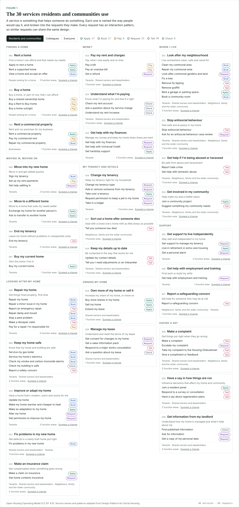
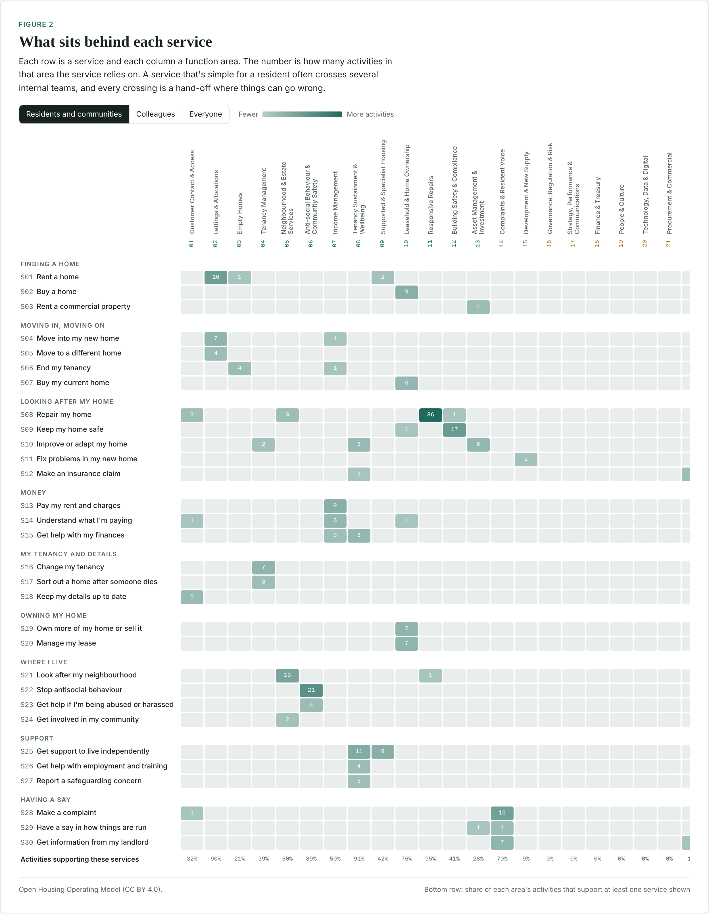
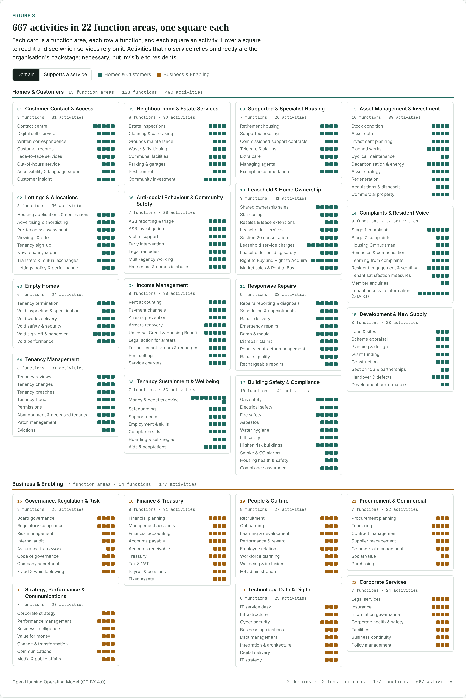

# Open Housing Operating Model

An open map of what a housing association does, in two views:

- **Services:** what residents, communities and colleagues are trying to get done, named the way they'd say it. "Rent a home", not "Lettings & Allocations".
- **The operating model:** how the organisation does the work behind those services, from function areas down to individual activities.

Every request a resident makes is linked to the activities it relies on.

<!-- BEGIN:counts -->
Version 0.2.0 has **41 services** made up of **100 requests**, delivered through **22 function areas, 177 functions and 667 activities**.
<!-- END:counts -->

It gives people across social housing a shared vocabulary for the work: for designing services, choosing systems, planning change, benchmarking or building products. It's a starting point built on judgement, published openly so the sector can improve it together.

## Explore it

- **Interactive atlas:** [richardsage.github.io/open-housing-operating-model](https://richardsage.github.io/open-housing-operating-model/). Browse the services, see what sits behind each one, and explore every activity.
- **Download the data:** `open-housing-services.csv` (one row per request), `open-housing-operating-model.csv` (one row per activity) and the full `open-housing-operating-model.json` are published alongside the atlas and attached to each [release](../../releases).
- **Read the source:** the service list is in [`model/services.yaml`](model/services.yaml), and there's one file per function area in [`model/function-areas/`](model/function-areas).

## How the model is structured

### Outside in: services

| Level | What it is | Example |
|---|---|---|
| Service | Something that helps someone do something, named by their goal | S08 Repair my home |
| Request | A specific thing someone does within that service, tagged with an interaction pattern | S08.4 Repair damp and mould (Book) |

Every request has one of six **interaction patterns**: Apply, Book, Pay, Request, Tell or Check. Requests that share a pattern can share a design: booking a repair, a gas service and a communal clean are all "Book".

### Inside out: the operating model

| Level | What it is | Example |
|---|---|---|
| Domain | The top split: front-line delivery, or the corporate functions that support it | Homes & Customers |
| Function area | A broad area of work, often one team or directorate | 11 Responsive Repairs |
| Function | A distinct part of that work, with its own outcome | 11.5 Damp & mould |
| Activity | A single task that someone, or something, carries out | 11.5.4 Monitor against Awaab's Law timescales |

### How they connect

Each request lists the functions or activities it `uses`. That shows what sits behind each service, and which activities are **backstage**: necessary, but not something any resident sees directly.

Codes are **permanent identifiers**: once published, a code always means the same thing, even if the item later moves or is retired. That lets other people's spreadsheets, products and analyses link to the model safely.

### Services

<!-- BEGIN:services -->
| Code | Service | Group | Requests |
|---|---|---|---|
| S01 | Rent a home | Finding a home | 3 |
| S02 | Buy a home | Finding a home | 3 |
| S03 | Rent a commercial property | Finding a home | 3 |
| S04 | Move into my new home | Moving in, moving on | 3 |
| S05 | Move to a different home | Moving in, moving on | 2 |
| S06 | End my tenancy | Moving in, moving on | 1 |
| S07 | Buy my current home | Moving in, moving on | 1 |
| S08 | Repair my home | Looking after my home | 7 |
| S09 | Keep my home safe | Looking after my home | 5 |
| S10 | Improve or adapt my home | Looking after my home | 5 |
| S11 | Fix problems in my new home | Looking after my home | 1 |
| S12 | Make an insurance claim | Looking after my home | 2 |
| S13 | Pay my rent and charges | Money | 3 |
| S14 | Understand what I'm paying | Money | 3 |
| S15 | Get help with my finances | Money | 3 |
| S16 | Change my tenancy | My tenancy and details | 5 |
| S17 | Sort out a home after someone dies | My tenancy and details | 1 |
| S18 | Keep my details up to date | My tenancy and details | 2 |
| S19 | Own more of my home or sell it | Owning my home | 3 |
| S20 | Manage my lease | Owning my home | 4 |
| S21 | Look after my neighbourhood | Where I live | 8 |
| S22 | Stop antisocial behaviour | Where I live | 2 |
| S23 | Get help if I'm being abused or harassed | Where I live | 2 |
| S24 | Get involved in my community | Where I live | 2 |
| S25 | Get support to live independently | Support | 3 |
| S26 | Get help with employment and training | Support | 1 |
| S27 | Report a safeguarding concern | Support | 1 |
| S28 | Make a complaint | Having a say | 4 |
| S29 | Have a say in how things are run | Having a say | 3 |
| S30 | Get information from my landlord | Having a say | 3 |
| S31 | Start a new job | Working here | 1 |
| S32 | Recruit a new employee | Working here | 1 |
| S33 | Get help with IT | Working here | 1 |
| S34 | Get training to help me improve | Working here | 1 |
| S35 | Get help with an absence issue | Working here | 1 |
| S36 | Get help with a conduct issue | Working here | 1 |
| S37 | Get help with a capability issue | Working here | 1 |
| S38 | Raise a complaint about my employer | Working here | 1 |
| S39 | Raise a concern to an external body | Working here | 1 |
| S40 | Claim my expenses | Working here | 1 |
| S41 | Give my resignation | Working here | 1 |
<!-- END:services -->

### Function areas

<!-- BEGIN:areas -->
| Code | Function area | Domain | Functions | Activities |
|---|---|---|---|---|
| 01 | Customer Contact & Access | Homes & Customers | 8 | 31 |
| 02 | Lettings & Allocations | Homes & Customers | 8 | 30 |
| 03 | Empty Homes | Homes & Customers | 6 | 24 |
| 04 | Tenancy Management | Homes & Customers | 8 | 31 |
| 05 | Neighbourhood & Estate Services | Homes & Customers | 8 | 30 |
| 06 | Anti-social Behaviour & Community Safety | Homes & Customers | 7 | 28 |
| 07 | Income Management | Homes & Customers | 9 | 38 |
| 08 | Tenancy Sustainment & Wellbeing | Homes & Customers | 7 | 33 |
| 09 | Supported & Specialist Housing | Homes & Customers | 7 | 26 |
| 10 | Leasehold & Home Ownership | Homes & Customers | 9 | 41 |
| 11 | Responsive Repairs | Homes & Customers | 9 | 38 |
| 12 | Building Safety & Compliance | Homes & Customers | 10 | 41 |
| 13 | Asset Management & Investment | Homes & Customers | 10 | 39 |
| 14 | Complaints & Resident Voice | Homes & Customers | 9 | 37 |
| 15 | Development & New Supply | Homes & Customers | 8 | 23 |
| 16 | Governance, Regulation & Risk | Business & Enabling | 8 | 25 |
| 17 | Strategy, Performance & Communications | Business & Enabling | 7 | 23 |
| 18 | Finance & Treasury | Business & Enabling | 9 | 31 |
| 19 | People & Culture | Business & Enabling | 8 | 27 |
| 20 | Technology, Data & Digital | Business & Enabling | 8 | 25 |
| 21 | Procurement & Commercial | Business & Enabling | 7 | 22 |
| 22 | Corporate Services | Business & Enabling | 7 | 24 |
<!-- END:areas -->

## What it's based on

The operating model draws on what every English provider has to do: the Regulator of Social Housing's consumer and economic standards, landlord safety duties (gas, electrical, fire, asbestos, water and lifts), the Building Safety Act, HHSRS, Awaab's Law, the Housing Ombudsman's Complaint Handling Code, the Tenant Satisfaction Measures and the Social Tenant Access to Information Requirements, plus how the sector usually organises its teams and costs.

It was inspired by Rannoch Associates' paper *The impact of AI on Housing Associations* (October 2026), which described, but didn't publish, a model of 22 areas, 173 services and 643 activities. This is an independent model, not their work.

The service list and interaction patterns are adapted, with thanks, from the [social housing service list](https://www.designpatternsforsocialhousing.co.uk/Social-housing-service-list-89c36fb8921944f79088b03c830c8584) by Design Patterns for Social Housing (Dave Skinner), whose pattern groups were mapped from TPXImpact's work on local government services. The approach follows the GOV.UK Service Manual's guidance on [creating a list of services](https://www.gov.uk/service-manual/design/create-a-list-of-services).

**Scope today:** a generic housing association in England. Scotland, Wales and Northern Ireland have different regulators and rules, and specialist providers (supported housing, almshouses, stock-transfer landlords, large developers) will weight things differently. Help with these is especially welcome.

## Contribute

You don't need to know Git or code to help. New to this? Start with the step-by-step guide, [HOW-TO-CONTRIBUTE.md](HOW-TO-CONTRIBUTE.md).

1. **Suggest a change:** use the [suggestion form](../../issues/new/choose) to add, rename, move or remove anything.
2. **Discuss bigger ideas:** use [Discussions](../../discussions) for new layers, regional versions or how you're using the model.
3. **Edit directly:** open `model/services.yaml` or a file in `model/function-areas/`, click the pencil icon, make your change and propose it. An automatic check confirms everything still fits together.

See [CONTRIBUTING.md](CONTRIBUTING.md) for naming rules and how codes work, and [GOVERNANCE.md](GOVERNANCE.md) for how decisions and versions are handled.

## Ideas for where it could go

- Testing service and request names with residents, and against real contact-reason data
- Services for councils, contractors and other partners
- Mapping the backstage dependencies behind each service (procurement, finance, data)
- Short descriptions and examples for every activity, and links to the regulation that requires them
- Versions for Scotland, Wales and Northern Ireland, and variants for specialist providers
- Optional layers others can add, such as roles, systems, data or performance measures, kept separate from the core model

## Use and licence

- **Model, data and documentation:** [Creative Commons Attribution 4.0](LICENSE.md) (CC BY 4.0). Use, adapt and share it, including commercially, as long as you give credit.
- **Build scripts and site code:** [MIT](LICENSE-CODE).

Suggested credit: *Open Housing Operating Model (CC BY 4.0)*, with the version you used. Citation details are in [CITATION.cff](CITATION.cff).
