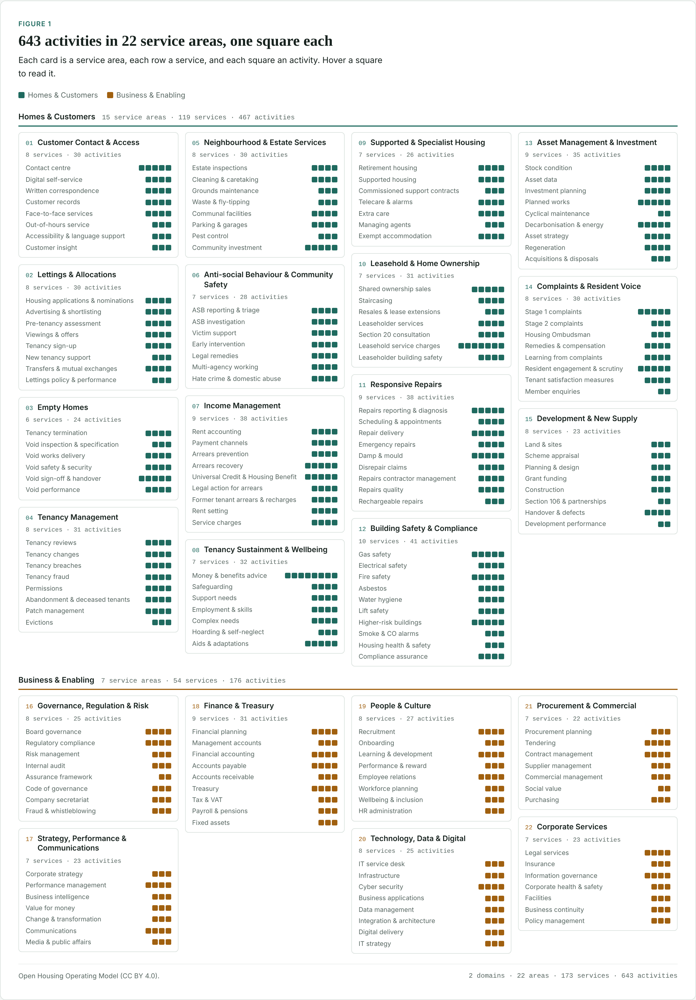
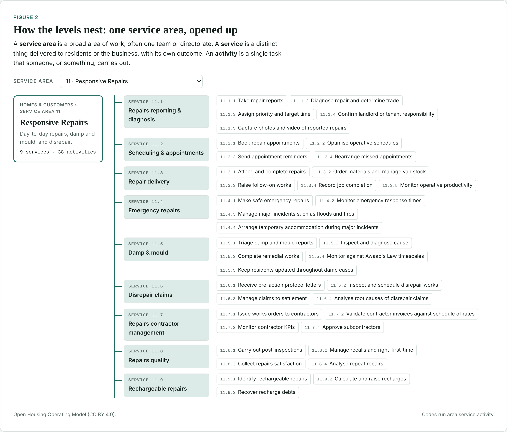

# Open Housing Operating Model

An open map of what a housing association does: **2 domains, 22 service areas, 173 services and 643 activities**, from answering a repair call to submitting regulatory returns.

It gives people across social housing a shared vocabulary for the work: for redesigning services, choosing systems, planning change, benchmarking or building products. It's a starting point built on judgement, published openly so the sector can improve it together.

## Explore it

- **Interactive atlas:** published from this repository with GitHub Pages (see the link in the About panel). Every activity is shown and searchable.
- **Download the data:** `open-housing-operating-model.csv` and `.json` are attached to each [release](../../releases) and published alongside the atlas.
- **Read the source:** one human-readable file per service area in [`model/areas/`](model/areas).

## How the model is structured

| Level | What it is | Example |
|---|---|---|
| Domain | The top split: front-line delivery, or the corporate functions that support it | Homes & Customers |
| Service area | A broad area of work, often one team or directorate | 11 Responsive Repairs |
| Service | A distinct thing delivered to residents or the business, with its own outcome | 11.5 Damp & mould |
| Activity | A single task that someone, or something, carries out | 11.5.4 Monitor against Awaab's Law timescales |

Codes run `area.service.activity` and are **permanent identifiers**: once published, a code always means the same thing, even if the item later moves or is retired. That lets other people's spreadsheets, products and analyses link to the model safely.

### Service areas

| Code | Service area | Domain | Services | Activities |
|---|---|---|---|---|
| 01 | Customer Contact & Access | Homes & Customers | 8 | 30 |
| 02 | Lettings & Allocations | Homes & Customers | 8 | 30 |
| 03 | Empty Homes | Homes & Customers | 6 | 24 |
| 04 | Tenancy Management | Homes & Customers | 8 | 31 |
| 05 | Neighbourhood & Estate Services | Homes & Customers | 8 | 30 |
| 06 | Anti-social Behaviour & Community Safety | Homes & Customers | 7 | 28 |
| 07 | Income Management | Homes & Customers | 9 | 38 |
| 08 | Tenancy Sustainment & Wellbeing | Homes & Customers | 7 | 32 |
| 09 | Supported & Specialist Housing | Homes & Customers | 7 | 26 |
| 10 | Leasehold & Home Ownership | Homes & Customers | 7 | 31 |
| 11 | Responsive Repairs | Homes & Customers | 9 | 38 |
| 12 | Building Safety & Compliance | Homes & Customers | 10 | 41 |
| 13 | Asset Management & Investment | Homes & Customers | 9 | 35 |
| 14 | Complaints & Resident Voice | Homes & Customers | 8 | 30 |
| 15 | Development & New Supply | Homes & Customers | 8 | 23 |
| 16 | Governance, Regulation & Risk | Business & Enabling | 8 | 25 |
| 17 | Strategy, Performance & Communications | Business & Enabling | 7 | 23 |
| 18 | Finance & Treasury | Business & Enabling | 9 | 31 |
| 19 | People & Culture | Business & Enabling | 8 | 27 |
| 20 | Technology, Data & Digital | Business & Enabling | 8 | 25 |
| 21 | Procurement & Commercial | Business & Enabling | 7 | 22 |
| 22 | Corporate Services | Business & Enabling | 7 | 23 |

## What it's based on

The structure draws on what every English provider has to do: the Regulator of Social Housing's consumer and economic standards, landlord safety duties (gas, electrical, fire, asbestos, water and lifts), the Building Safety Act, HHSRS, Awaab's Law, the Housing Ombudsman's Complaint Handling Code and the Tenant Satisfaction Measures, plus how the sector usually organises its teams and costs.

Its size mirrors the model described in Rannoch Associates' paper *The impact of AI on Housing Associations* (October 2026). That model wasn't published, so this is an independent reconstruction, not their work.

**Scope today:** a generic housing association in England. Scotland, Wales and Northern Ireland have different regulators and rules, and specialist providers (supported housing, almshouses, stock-transfer landlords, large developers) will weight things differently. Help with these is especially welcome.

## Contribute

You don't need to know Git or code to help.

1. **Suggest a change:** use the [suggestion form](../../issues/new/choose) to add, rename, move or remove anything.
2. **Discuss bigger ideas:** use [Discussions](../../discussions) for new layers, regional versions or how you're using the model.
3. **Edit directly:** open a file in `model/areas/`, click the pencil icon, make your change and propose it. An automatic check confirms the structure is still valid.

See [CONTRIBUTING.md](CONTRIBUTING.md) for naming rules and how codes work, and [GOVERNANCE.md](GOVERNANCE.md) for how decisions and versions are handled.

## Ideas for where it could go

- Short descriptions and examples for every activity
- Links from activities to the regulation or guidance that requires them
- Versions for Scotland, Wales and Northern Ireland
- Variants for supported housing, retirement living and stock-transfer landlords
- Optional layers others can add, such as typical roles, systems, data or performance measures, kept separate from the core model

## Use and licence

- **Model, data and documentation:** [Creative Commons Attribution 4.0](LICENSE.md) (CC BY 4.0). Use, adapt and share it, including commercially, as long as you give credit.
- **Build scripts and site code:** [MIT](LICENSE-CODE).

Suggested credit: *Open Housing Operating Model, v0.1.0 (CC BY 4.0)*. Citation details are in [CITATION.cff](CITATION.cff).
